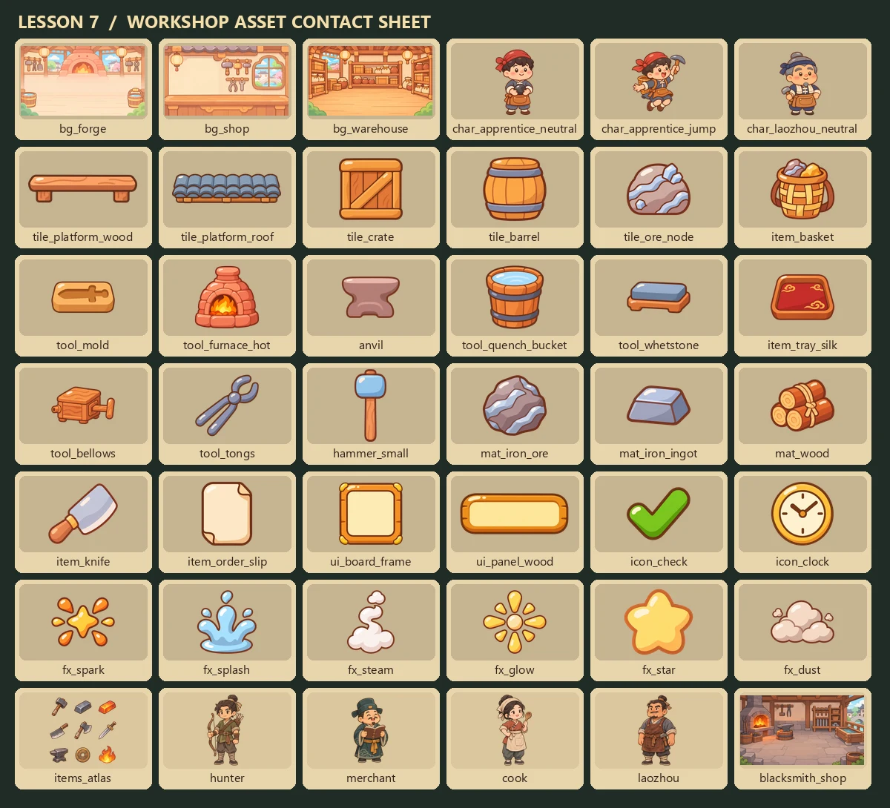
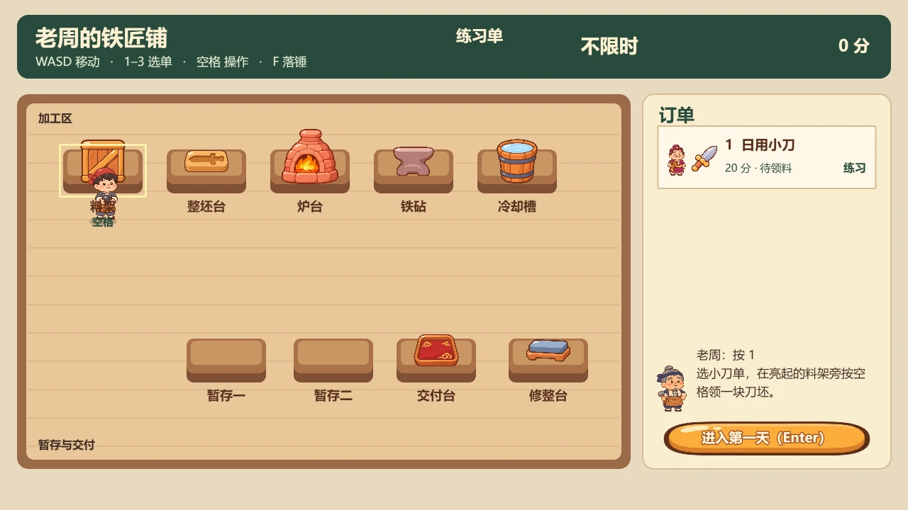
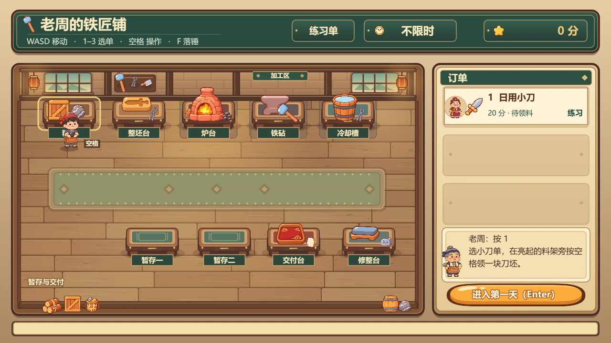
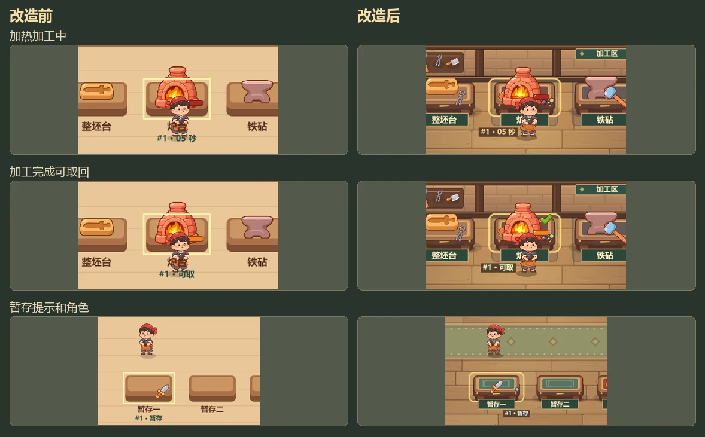
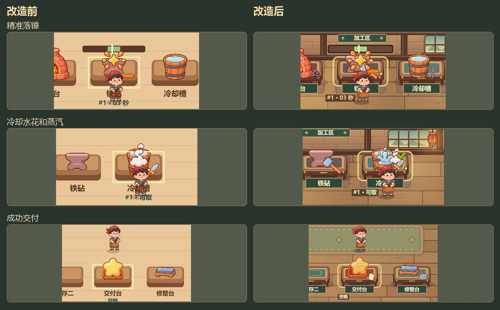
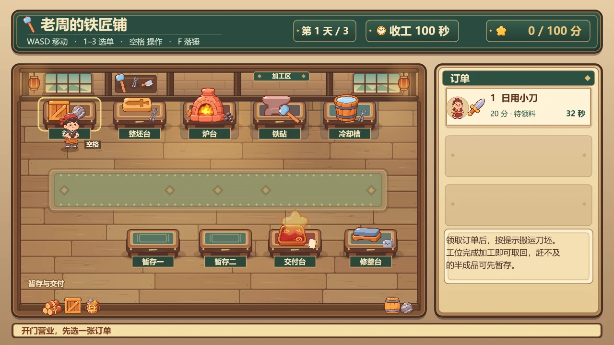

# 老周的铁匠铺场景视觉升级报告

本次以 `main` 的 `a63bfa2` 为对照，在 `feat/visual-polish` 上升级营业和练习共用的铁匠铺画面。场景绘制和工位提示由独立模块负责，玩法继续使用原版配置和规则。截图在 1280 × 720 的浏览器中用同一条键盘路线采集。

## 原场景和设计方向

原场景的地板由平行横线构成，边缘没有墙面和陈设。工位共用形状相同的底座，工作状态主要依赖小字，学徒站在工位正前方时容易与文字重合。

新版沿用课程模板的圆润 Q 版古风，以砖墙、木梁、格窗和灯笼围合店面。错缝木板、织纹地垫和工位阴影组成俯视动线。炉火用暖橙光，墙饰、工位铭牌和订单板用深绿与古金。墙上的工具和边缘的木料、矿石、木箱与木桶保持在通道外侧。

## 课程素材与许可

工作区「初始材料/lesson7」中的《AI Native的游戏开发实践.zip》包含 2D 原画、道具图集、四套参考框架、AI 素材包，以及 Kenney UI、RPG 音效和 KayKit 的 CC0 原包。用 SHA-256 比对，项目的 180 张已登记图片与课程 ZIP 内的「网页游戏起步模板」逐张一致，故直接引用现有资源。单独提供的原画适合做布景参考，课堂 3D 素材、CC0 素材、附带字体及示例代码均未引入游戏。

| 用处 | 采用的 WebP 素材 ID |
| --- | --- |
| 墙饰与边缘杂物 | `hammer_small`、`tool_tongs`、`item_knife`、`mat_wood`、`tile_crate`、`item_basket`、`tile_barrel`、`mat_iron_ore` |
| 料架、各加工台、交付台 | `mat_iron_ingot`、`tool_mold`、`tool_bellows`、`tool_furnace_hot`、`mat_charcoal`、`anvil`、`tool_quench_bucket`、`tool_whetstone`、`item_scrap`、`item_tray_silk`、`item_order_slip` |
| 角色、计时与反馈 | 原学徒 `char_apprentice_neutral`、老周和顾客立绘、`icon_clock`、`icon_star`、`icon_check`、`fx_spark`、`fx_splash`、`fx_steam`、`fx_star` |

完整文件路径可在 [素材清单](../assets/manifest.json) 查询。课程模板的图像来源和使用说明保留在 [README](../README.md#素材来源与许可)，[素材索引](../assets/ASSETS.md) 和 [原画风说明](../assets/STYLE.md) 继续适用。地板、墙面、桌体和灯光由代码绘制。音频沿用原配乐和合成音效。

## 已完成的视觉改进

- 各工位使用统一木作台体，以台面用料、工具和配色区分整坯、炉台、铁砧、冷却及修整，另外为暂存铺垫、交付加托盘。附近工位用金色轮廓，教学目标用绿色轮廓。加工中显示琥珀状态灯和进度条，完成后显示浅绿状态灯及短促对勾，暂存显示蓝色状态灯。角色靠近时，状态牌让到角色的另一侧。
- 学徒复用现有立绘，脚底阴影、横向朝向、移动时的小幅起伏和随位置变化的遮挡顺序让人物融入铺面。道具图标随持刀方向显示。
- 炉膛暖光缓慢脉动并飘出火星。落锤、冷却和交付分别出现火花、水花与蒸汽、金色星光。短时特效结束后销毁，房间底图只绘制一次并在场景重进时复用。
- 订单板、顶栏、读数和提示框统一用墨绿、古金和暖纸色。倒计时与订单仍取自原有状态，封面、结算和按钮行为沿用原版。

## 文件

| 文件 | 内容 |
| --- | --- |
| `src/scenes/play.ts` | 将原场景的状态和事件接到新版画面，调整原有 UI 的视觉 |
| `src/scenes/workshop-room.ts` | 缓存的房间底图、材质、窗灯、陈设和界面外框 |
| `src/scenes/workshop-stations.ts` | 工位台体、状态反馈、炉火和短时特效 |
| `tests/workshop-visual-smoke.mjs` | 真实键盘和浏览器画面回归 |
| `docs/visual-polish-report.md`、`docs/visual-polish-media/` | 素材盘点、截图和验收记录 |

## 验收结果

| 命令 | 结果 |
| --- | --- |
| `npm run check` | TypeScript 类型检查通过，2 个测试文件共 14 项通过 |
| `npm run shot -- play` | 封面和教学主场景均非空画布，控制台无报错。项目原有的 9 个可选音效仍由合成音提供 |
| `node tests/browser-smoke.mjs` | 项目既有浏览器用例通过，精准小刀得 25 分并进入第一天 |
| `node tests/workshop-visual-smoke.mjs` | 新版流程、工位状态和特效回归通过 |
| `npm run build` | Vite 生产构建通过 |

浏览器测试从封面进入教学，完成领料、搬运、加热、精准落锤、冷却、暂存、取回和交付，练习单得 25 分，进入第一天后从零分开始。实测加工、完成、暂存状态及落锤、冷却、交付动画。超时用例把营业时钟设置到一张已放入工位的订单的截止前，随后由游戏正常帧更新触发超时，确认订单和台上刀坯被收回、状态灯清除。测试采集的控制台及请求错误均为空。

复跑视觉验收时，先启动游戏服务，然后在项目根目录执行 `node tests/workshop-visual-smoke.mjs`。可通过 `WORKSHOP_URL` 指定服务地址，通过 `WORKSHOP_SHOTS` 写出截图。

## 改造前后

原版完整场景

新版完整场景

工位、状态提示和角色

精准落锤、冷却与交付

第一天营业

## 仍有的限制

课程模板中的学徒是静态正面立绘，当前的步态反馈由朝向、微起伏和脚底阴影表达。浏览器验收覆盖练习到第一天营业及超时回收。三天通关与重试由现有规则测试覆盖，尚未在浏览器中逐日打完。未做低性能设备的帧率测试。
