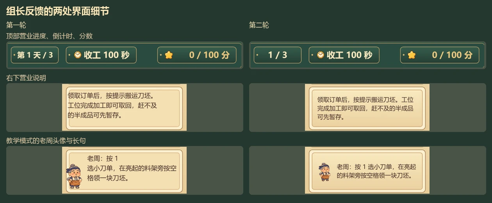
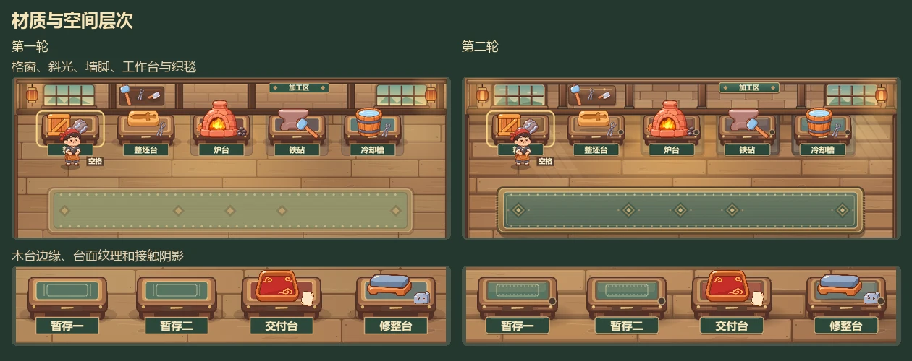
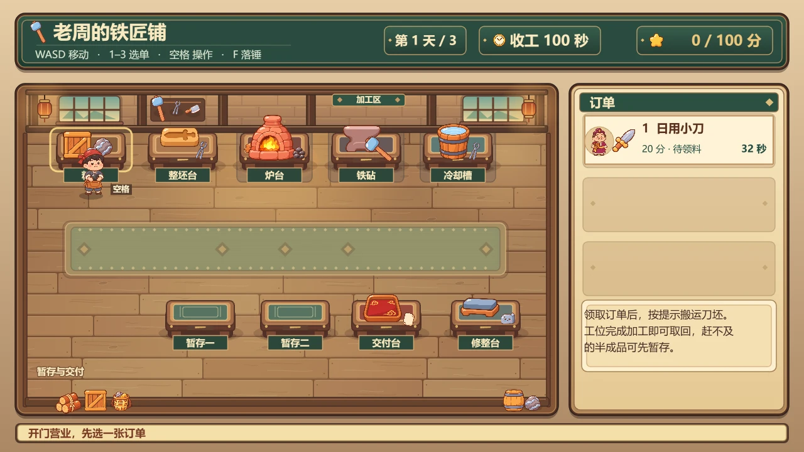
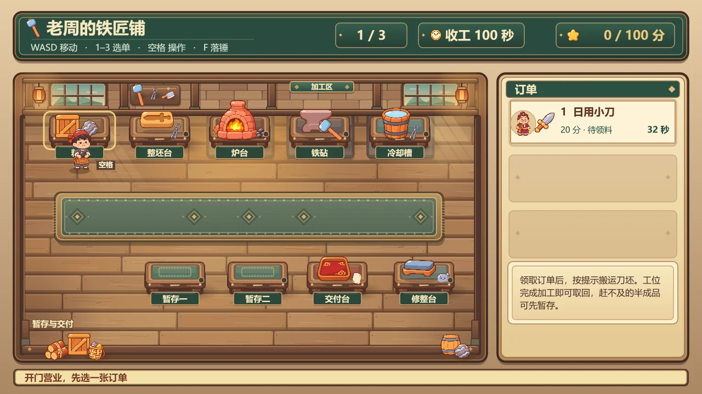
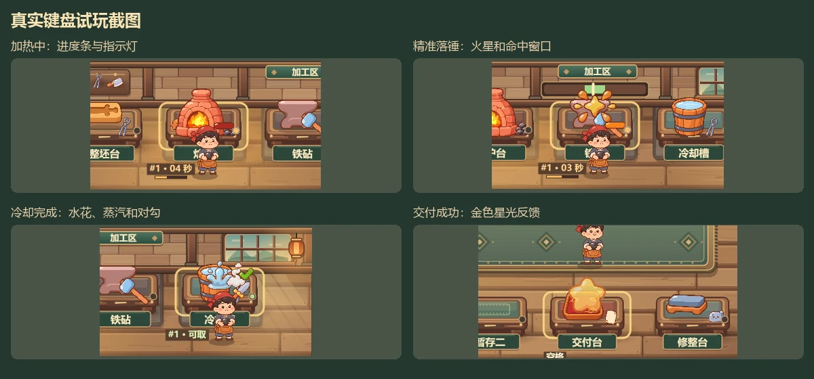
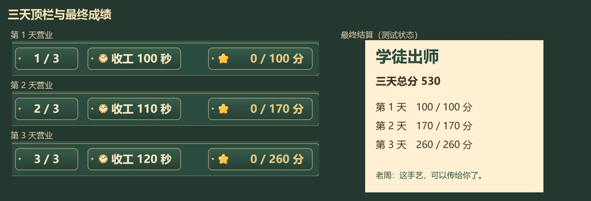
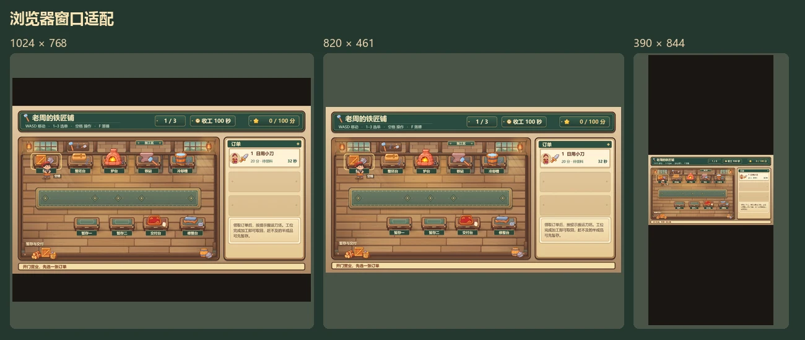

# 老周的铁匠铺第二轮视觉升级报告

第二轮从已合并第一轮 PR 的 `origin/main`（`69e7645`）建立 `feat/visual-polish-v2`。本轮先修正组长反馈的顶栏和说明框，再细化原铺面的墙地关系、木作工位和炉火环境。前后对照使用相同窗口尺寸和游戏坐标。

## 组长反馈

| 问题 | 修复 |
| --- | --- |
| 顶栏显示「第 1 天 / 3」 | 营业进度简写为 `1 / 3`、`2 / 3`、`3 / 3`，数字水平居中并与倒计时、分数共用高度。练习仍显示「练习单」，每日和最终结算继续显示完整天数标题。 |
| 右下说明文字贴近边框 | 内框与文字共用坐标。营业文字左右各留 14 个场景像素，多行文字垂直居中。教学头像有独立列，按汉语词边界换行，并将常见句末标点与前词同放。练习与营业提示文案均沿用原文。 |

## 场景品质

- 后墙用不同色温的砖面、带阴影的木柱、分层的窗外山景和窗台收边。由窗格向地板落下的斜光与墙脚暗部把立面和地面分开。边缘木料、木箱和矿石组合成两处存料角，置于通道外侧。
- 地板采用错缝、微小木节与沿木板走向的高光。炉台、铁砧和冷却槽下放入低饱和石垫。中央深绿织毯以金线、织纹和窄流苏划分通道，保留走动空间。
- 工位加入木缘倒角、金属件高光和工具接触阴影。加工进度条移到状态牌下方，靠近时和状态牌一起避开学徒。状态灯有短促的点亮过渡，原有高亮、完成提示和交付反馈仍由原事件驱动。
- 炉台照明复用渐隐光斑，冷却槽增加一圈低透明度水波。底图和光影贴图缓存复用，波纹与炉光始终使用固定对象，原有一次性特效按动画结束销毁。

## 素材与边界

复用老师《AI Native的游戏开发实践》网页游戏起步模板中已经登记的素材。墙面工具使用 `hammer_small`、`tool_tongs`、`item_knife`。边缘材料使用 `mat_wood`、`tile_crate`、`item_basket`、`tile_barrel`、`mat_iron_ore`。工位、角色和特效使用现有登记项。新增的木纹、砖面、织毯、光影和水纹由代码绘制，课程模板的来源和使用说明见 [README](../README.md#素材来源与许可) 和 [第一轮报告](visual-polish-report.md#课程素材与许可)。

工位坐标、地图和交互区域沿用原布局。与基线比对，核心规则、数值配置、引擎、封面、结算和素材目录均一致。

| 文件 | 修改内容 |
| --- | --- |
| `src/scenes/play.ts` | 顶栏比例计数、说明框内的文字排版与气氛动画调用 |
| `src/scenes/workshop-room.ts` | 窗、墙、木板、石垫、织毯、边缘陈设与缓存光影 |
| `src/scenes/workshop-stations.ts` | 工位材质、状态灯、进度条及炉光、水波 |
| `tests/workshop-hud-smoke.mjs` | 浏览器检查三天和结算、说明框边界及窗口缩放 |
| `tests/workshop-visual-smoke.mjs` | 在原键盘流程上增加环境动画及进度条检查 |
| `docs/visual-polish-v2-report.md`、`docs/visual-polish-v2-media/` | 本轮验收记录与实拍图 |

## 验收结果

| 命令 | 结果 |
| --- | --- |
| `npm run check` | 类型检查通过，2 个文件共 14 项测试通过。 |
| `npm run build` | Vite 生产构建通过。 |
| `node tests/browser-smoke.mjs` | 键盘完成练习单，精准小刀得 25 分，第一天从零分开始。 |
| `node tests/workshop-visual-smoke.mjs` | 教学、移动、领料、加工进度、精准落锤、冷却、暂存、交付、超时回收、炉光与水波通过。浏览器无控制台错误。 |
| `node tests/workshop-hud-smoke.mjs` | `1 / 3` 至 `3 / 3`、每日与最终结算、说明框留白和对齐通过。画面在 1280×720、1024×768、820×461、390×844 下保持原比例，说明文字无裁切。 |
| `npm run shot -- play` | 封面与教学场景均成功截图，控制台无报错。原有 9 个可选音效仍由合成音提供。 |

三天界面检查将每天状态设置到达标收工前，再由真实帧更新和空格按键进入每日结算、下一天及最终结算。超时回收同样将时钟设到订单截止前，由实际更新触发回收。完整的键盘加工与交付在练习单实测，逐单打通三天由原有规则测试覆盖。

## 实拍与对照

第一轮营业画面

第二轮营业画面

## 仍有的限制

学徒沿用第一轮的正面立绘及走动表现。竖屏用例验证画面比例和排版，游戏继续使用键盘操作。低性能设备的帧率和浏览器逐单通关三天尚未实测。
